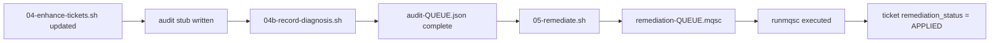

# MQ AI Agent — Improvement Plan
## Approved Items: BobShell Audit Logging + MQSC Remediation Script

---

## Top-Level Overview

Two improvements are approved from the hackathon evaluation:

1. **Improvement 3 (Approved) — BobShell Audit Logging**
   Add a structured `bob-audit.json` file alongside each ticket, capturing the Bob session timestamp, the diagnostic instruction sent, and the agent's response. This provides a machine-readable, human-reviewable audit trail of every AI-driven diagnosis — directly addressing the Governance & Auditability gap identified in the evaluation.

2. **Improvement 1 (Approved) — `05-remediate.sh` MQSC Extraction and Execution Script**
   A new fifth script that reads a Bob diagnosis response (stored as text), extracts any MQSC commands from it, presents them for human approval, and — if approved — executes them against QMS1 via `runmqsc`. This closes the agentic loop: detect → diagnose → remediate.

Both scripts are independent, follow the same conventions as the existing four, and are wired into `run-all.ps1` as optional steps.

---

## Sub-Task 1 — BobShell Audit Logging

**Status:** [x] done

### Intent
After each Bob diagnosis session, write a `bob-audit.json` file into the `tickets/` directory alongside the ticket it relates to. This gives the project a traceable, auditable record of every AI action — a key enterprise governance requirement and a direct scoring improvement for Criterion 2.

Since BobShell logs live at `~/.bob/logs/` and Bob non-interactive sessions can be invoked with `bob -p "prompt"`, the audit record is built by:
- Capturing the diagnostic instruction sent
- Capturing the timestamp and a session ID (generated by the script)
- Capturing Bob's response text (when invoked via BobShell non-interactive mode)
- Writing all of this to `tickets/audit-<QUEUE>.json`

For the IDE (non-BobShell) workflow used in this project, the audit log is written manually: the user pastes the Bob response into a file, and `04-enhance-tickets.sh` is extended to also write the audit record. A BobShell-native variant is documented for future use.

### Expected Outcomes
- A file `tickets/audit-<QUEUE>.json` is created for each diagnosed queue
- The file contains: `ticket_id`, `queue_name`, `queue_manager`, `diagnosis_timestamp`, `diagnostic_instruction`, `bob_response` (text), `session_source` (IDE or BobShell), `audit_version`
- `04-enhance-tickets.sh` is updated to create a stub audit file at enhancement time (to be filled with Bob's response after diagnosis)
- A new `04b-record-diagnosis.sh` script accepts a ticket file and a Bob response text file and writes the completed audit record
- `run-all.ps1` documents the audit step in its completion banner

### Todo List
- [x] Design the `bob-audit.json` schema (fields, types, example)
- [x] Update `04-enhance-tickets.sh` to write a stub `audit-<QUEUE>.json` alongside each enhanced ticket (fields: ticket_id, queue_name, queue_manager, diagnostic_instruction, diagnosis_timestamp=null, bob_response=null, session_source="IDE", audit_version="1.0")
- [x] Create `04b-record-diagnosis.sh`: reads ticket file + Bob response text file, fills in `diagnosis_timestamp` and `bob_response`, writes completed audit record
- [x] Update `run-all.ps1` completion banner to mention audit files and show their path
- [x] Update `README.md` with audit file description, schema, and usage example
- [x] Update `prompt-history.md` with this change

### Relevant Context
- Existing tickets: `tickets/ticket-ACME.*.json`
- `04-enhance-tickets.sh`: enhancement pattern to follow (read ticket, add field, write back)
- BobShell logs location: `~/.bob/logs/` (documented in Bob Shell troubleshooting docs)
- BobShell non-interactive: `bob -p "prompt"` or `cat prompt.txt | bob` (documented in Bob Shell non-interactive docs)
- All bash scripts must be written with LF line endings via `[System.IO.File]::WriteAllText` with explicit UTF-8 encoding (established pattern from prior work)

---

## Sub-Task 2 — `05-remediate.sh` MQSC Extraction and Execution

**Status:** [x] done

### Intent
Create a new standalone script that:
1. Reads a Bob diagnosis response (from the audit file or a text file)
2. Extracts any MQSC commands embedded in the response (lines that look like `ALTER QLOCAL(...)`, `CLEAR QLOCAL(...)`, `START CHANNEL(...)`, etc.)
3. Writes those commands to a `remediation-<QUEUE>.mqsc` file for human review
4. Prompts for explicit human approval before executing
5. If approved, executes the MQSC via `runmqsc.exe` against QMS1
6. Updates the ticket's `remediation_status` field from `PENDING` to `APPLIED`
7. Appends the result to the audit file

This closes the loop: the pipeline goes from detect → diagnose → **remediate** with a human gate before any queue state is changed.

### Expected Outcomes
- A new script `05-remediate.sh` exists and passes `bash -n` syntax check with LF line endings
- Running `./05-remediate.sh tickets/ticket-ACME.APPDATA.QUEUE.json` extracts MQSC from the associated audit file and writes `tickets/remediation-ACME.APPDATA.QUEUE.mqsc`
- The script displays the proposed MQSC commands and asks `Approve? [y/N]` before executing
- If approved, `runmqsc.exe QMS1 < remediation-<QUEUE>.mqsc` is executed and output shown
- The ticket's `remediation_status` field is updated to `APPLIED` (or `REJECTED` if denied)
- The audit file is updated with `remediation_timestamp` and `remediation_outcome`
- `run-all.ps1` is updated to mention `05-remediate.sh` in the completion banner as an optional next step
- `README.md` is updated with Step 5 instructions
- `prompt-history.md` is updated with this change

### Todo List
- [x] Add `remediation_status: "PENDING"` and `remediation_mqsc: null` fields to ticket schema in `03-scan-queues.sh`
- [x] Create `05-remediate.sh` with the following flow:
  - Accept a ticket JSON file as argument (required)
  - Derive the audit file path from the ticket path (`audit-<QUEUE>.json`)
  - Extract MQSC-like lines from `bob_response` in the audit file using pattern matching (lines starting with known MQSC verbs: ALTER, CLEAR, START, STOP, DEFINE, DISPLAY, REFRESH)
  - If no MQSC found, print `[INFO] No MQSC commands found in diagnosis - nothing to remediate.` and exit 0
  - Write extracted commands + `END` to `tickets/remediation-<QUEUE>.mqsc`
  - Display the file contents and prompt `Approve and execute? [y/N]:`
  - On `y`: run `runmqsc.exe QMS1 < remediation-<QUEUE>.mqsc`, capture output, update ticket + audit
  - On anything else: update ticket `remediation_status` to `REJECTED`, exit 0
- [x] Update `03-scan-queues.sh` to include `remediation_status` and `remediation_mqsc` in ticket output
- [x] Update `run-all.ps1` completion banner to show `05-remediate.sh` as optional next step
- [x] Update `README.md` with Step 5 (optional remediation)
- [x] Update `prompt-history.md`

### Relevant Context
- MQSC verb patterns to match: `ALTER`, `CLEAR`, `START`, `STOP`, `DEFINE`, `REFRESH`, `RESET`
- `runmqsc.exe` location: `C:\Program Files\IBM\MQ\bin\runmqsc.exe` (WSL: `/mnt/c/Program Files/IBM/MQ/bin/runmqsc.exe`)
- Ticket update pattern: see `04-enhance-tickets.sh` (head -n -1, sed for comma, printf append)
- All bash scripts: LF line endings, no `set -euo pipefail` around Windows exe calls
- Confirmed live diagnosis examples (from `prompt-history.md`):
  - APPDATA: recommended `ALTER QLOCAL(ACME.APPDATA.QUEUE) GET(ENABLED)`
  - COMMERCE: recommended `CLEAR QLOCAL(ACME.COMMERCE.QUEUE)` (with caution)

---

## Implementation Order

```
Sub-Task 1 first (audit logging) — Sub-Task 2 depends on the audit file for its MQSC source
```



---

## Scope Boundaries (What This Plan Does NOT Change)
- `01-setup-qmgr.ps1` — no changes
- `02-load-messages.sh` — no changes
- `03-scan-queues.sh` — minor addition only (two new fields in ticket JSON)
- `qms1-setup.mqsc` — no changes
- Custom Bob modes (`custom_modes.yaml`) — deferred to Improvement 2, pending Bob coin budget review
